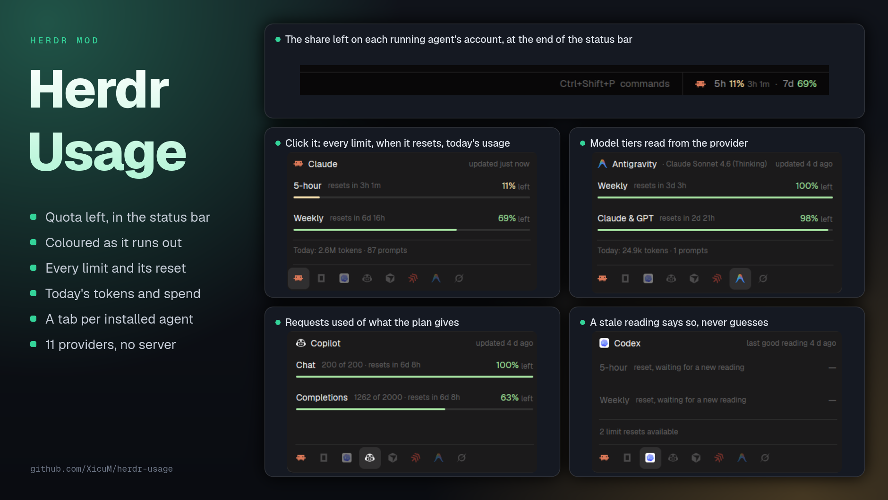

# Herdr Usage

How much quota is left on each AI account your running agents use, at the right end of Herdr's status bar: the agent's icon, a draining bar with a pace tick, and each window's share left ("5h 62% · 7d 17%"), coloured as it runs out. Click a provider for a popup with every limit, when it resets, how its pace compares with the window, paid credit past the limits, and today's and the week's tokens, prompts and spend, with a tab for every installed agent's account.

It covers Claude, Codex, Antigravity/Gemini, Grok, OpenCode Go, Copilot, Cursor, OpenRouter, DeepSeek, Pi and Amp, and reads their usage itself, with no server or companion app.



## Install

```sh
git clone https://github.com/XicuM/herdr-usage.git
cp -R herdr-usage/mods/herdr-usage ~/.config/herdr-app/mods/
```

Then, in your layout (`herdr-app do layout.clone '{"name":"main","as":"my-main"}'` first if you use one of Herdr's own layouts), make the status row hold `workspace-status` and `herdr-usage`:

```json
{ "id": "status-row", "type": "row", "size": { "px": 28 }, "resizable": false, "children": [
  { "id": "status", "type": "block", "size": { "weight": 1 }, "content": { "mod": "workspace-status" } },
  { "id": "usage", "type": "block", "size": { "weight": 1 }, "content": { "mod": "herdr-usage" } } ] }
```

The mod sizes its own block to its text. Copy the mod, don't symlink it: Herdr won't load icons through a link that leaves its home. It doesn't hot-reload either; switch layouts away and back after copying.

## What you see

- **The bar**: one group per provider of the agents running now, in the agents' order. Several agents on one account share one group. Each limit is a short label, a 26×3px bar draining with the share **left**, a 1px tick at the **time left**, and the percent left. The share is green below 75% used, amber from 75%, red from 90%. Amber and red also add the time to reset (`· 2d 10h`).
- **The pace tick**: bar past the tick means quota is going faster than the window. Hover a group for the numbers ("33% of the window left · using it faster than the window").
- **Honest states**: a provider that fails keeps its last good reading, dimmed, with `!` and its age. A window whose reset time has passed shows `—`, never a guessed 0%. A reading over 15 minutes old is dimmed.
- **The popup**: flat like Herdr's menus. Every limit has its label, detail, reset and share left, with a bar and pace tick. Extra usage and credits get a row without a bar. Antigravity's Claude and GPT tiers are one row. A reset line appears when Claude or Codex offers a usage-limit reset. At the bottom, one tab per provider: the running ones first, then the other installed agents', dimmed and read when picked.
- **Today's and the week's spend**: `Today: 1.2M tokens · 51 prompts · $3.40 · 7d 4.5M tokens`, where the source records it. OpenCode and Pi show tokens over seven days; OpenRouter adds week and month dollars.
- **Spend-only providers**: OpenCode without a Go key and Pi have no limits; the bar shows `today 240k` and the popup shows today and the week.

## Providers

| Provider | Limits | Tokens, prompts and spend |
| --- | --- | --- |
| Claude | `claude` CLI `get_usage` (5-hour, weekly, per-model weekly); falls back to the OAuth usage endpoint | `~/.claude/projects/**/*.jsonl` |
| Codex | `codex app-server` `account/rateLimits/read` (all limit groups); falls back to `wham/usage` then its logs | `~/.codex/sessions/**/*.jsonl` |
| Antigravity | `agy -p /usage --output-format json`, run from `/` | `~/.gemini/antigravity-cli/brain`, `~/.gemini/tmp` |
| Grok | `~/.grok/auth.json` → `cli-chat-proxy.grok.com/v1/billing` | `~/.grok/sessions/**/updates.jsonl` |
| OpenCode Go | key from OpenCode's database or auth files → `opencode.ai/zen/go/v1/usage` | OpenCode's database: today and 7 days |
| Copilot | `hosts.json`, `gh auth token` or `$GITHUB_TOKEN` → `copilot_internal/user` | none |
| Cursor | `~/.cursor/auth.json` or `credentials.json` → `cursor.sh/api/usage` | none |
| OpenRouter | key file or `$OPENROUTER_API_KEY` → `auth/key` and `/credits` | daily, weekly and monthly spend |
| DeepSeek | key file or `$DEEPSEEK_API_KEY` → `user/balance` | none |
| Pi | none | `~/.pi/agent/sessions/**/*.jsonl`, today and 7 days |
| Amp | `amp usage` credit pools | its token total and recorded cost |

## What it runs

- The `claude` CLI, briefly, every 2 minutes, and the `codex` app-server, briefly, every 5 minutes. They use their own sign-ins and talk to Anthropic and OpenAI. No prompt is sent and no turn is started.
- If a CLI is missing or fails, the mod falls back to the provider's own official-client endpoint, using the token already in `~/.claude/.credentials.json` or `~/.codex/auth.json`. Tokens are only put in a request header; they are never written to shared state, logged or stored.
- `curl`-equivalent `fetch` requests to the usage endpoints above, at most every 5 minutes (Anthropic's fallback every 2 minutes).
- `sh`, `find`, `grep` and `sqlite3` to read transcripts and local databases read-only. `sqlite3` is always `-readonly`, so it never creates an empty `opencode.db`.
- `agy` every 5 minutes while Antigravity is running, from `/`, so no project's MCP servers or instructions load. `amp usage` every 5 minutes. `gh auth token` only when no Copilot token file exists.
- It reads the conversation in the focused providers' transcripts and local databases, but passes on numbers only (counts, tokens, times, model ids).
- Environment overrides: `HERDR_USAGE_CLAUDE_BIN`, `HERDR_USAGE_CODEX_BIN`, `HERDR_USAGE_OPENCODE_GO_KEY`, `HERDR_USAGE_OPENCODE_GO_ORG`, `HERDR_USAGE_OPENCODE_GO_AUTH`.

Note: `get_usage` and `account/rateLimits/read` are internal interfaces, and several fallback endpoints are undocumented. They can change without notice. The CLI path is used first where it works.

## Development

```sh
npm test                                    # node --test, no dependencies
herdr-app check mods/herdr-usage
rsync -a --delete mods/herdr-usage/ ~/.config/herdr-app/mods/herdr-usage/
```

`mods/herdr-usage/usage.js` is pure parsing and display rules, with no Herdr imports, so `node --test` covers it. `main.js` reads the sources and draws. The CLI helpers are in `mods/herdr-usage/helpers/`.

[RECIPE.md](RECIPE.md) is the full behaviour and design brief.

## Credits

The CLI helpers and several ideas — per-model windows, the pace tick, explicit stale and passed-reset states, the OpenCode store dedupe — are adapted from [nozikov/herdr-usage-limits](https://github.com/nozikov/herdr-usage-limits) (MIT). The approach for Claude's `get_usage` comes from [jmalicki/herdr-mod-ai-usage](https://github.com/jmalicki/herdr-mod-ai-usage) (MIT). The rest is ported from herdr-bridge's `usage.rs`.

## License

MIT
