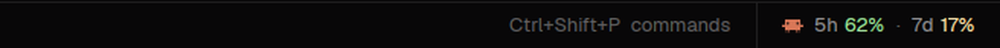

# Herdr Usage

How much quota is left on each AI account your running agents use, at the right end of Herdr's status bar: the agent's icon, then each window's share left ("5h 62% · 7d 17%"), coloured as it runs out. Click a provider for a popup with each limit, when it resets, and today's tokens and prompts. It covers Claude, Codex, Antigravity/Gemini, Grok, OpenCode Go, Copilot, Cursor, OpenRouter, DeepSeek and Amp, and reads their usage itself, with no server or companion app.

## What you see

- **The status bar's right end**, after Herdr's own status (`workspace-status`): a 1px `border` divider, then one group per provider of the agents running now, in the agents' order. Several agents on one account share one group.
  - It's drawn as part of the bar: `chrome` background, 1px `border` top edge, 11.8px `muted` text, 8px padding either side of the groups. The block is exactly as wide as its groups, so no gap opens beside them; with no agents running it is empty, without the divider.
  - A group is 22px tall, 6px padding, 6px gaps, 6px apart from the next, rounded 5px, `hover` background on hover, pointer cursor. It shows the agent's icon at 13px (a one-colour glyph in `muted`, or the picture as is), or the provider's name in `foreground` when the agent has no icon.
  - Then each main limit, as a short label and the share **left**, semibold: "5h 62%", "7d 17%", "30d 80%" ("5h" for 5-hour windows, "7d" for weekly, "30d" for monthly, "45m"/"3h" for other windows, otherwise the label as given), separated by a `dim` "·". The share is coloured by how much is used: `done` (green) below 75% used, `working` (amber) from 75%, `blocked` (red) from 90%.
  - A balance with no limit (DeepSeek) shows its amount instead, in `foreground` ("Balance (USD) 4.20 USD"). A provider known but with no limit yet shows a `dim` "–".
  - Tooltip: "Claude: quota left; click for details".
- **The popup** (320×420, `popover` background, 14px padding, 8px gaps, 12.5px `foreground` text):
  - The icon at 20px, the provider's name (14px bold) and its plan below (11px `muted`: "Team", "OpenCode Go", "Copilot Business").
  - One card per limit (`raised`, rounded 8px, 10px padding, 6px gaps): the label (semibold) and "38% left" (bold, in the tone colour); a 6px bar rounded 3px, `border` track, filled to the share **used** in the tone colour; below, 11px `muted`, "62% used" and "Resets in 2h 13m" ("in 3d 4h", "in 12m", "in < 1m", "shortly").
  - Antigravity's Claude and GPT model tiers come after the main ones, under an 11px `muted` "Other models".
  - A balance card shows the label and the amount, without a bar.
  - "No rate limits recorded." when there are none.
  - A last card, when known: today's tokens ("1.2M", "3.4k") and prompts, 15px bold over 11px `muted` "Tokens today" / "Prompts today".

## How it behaves

- Every 5s it looks at which providers the running agents use, and reads any whose numbers are over 30s old. Agent statuses (working, blocked, done, idle) don't change what it shows: only which providers are running.
- The provider's own usage endpoints are asked at most every 5 minutes, Anthropic's every 2 minutes (it refuses more often), `agy` and `amp usage` every 5 minutes. A request that never answers holds that source for one such wait. Between them the last answer stands. Today's tokens and prompts come from the agents' local transcripts on every read.
- A provider that stops answering keeps its last limits for 3 minutes, then they're dropped. Claude's limits stay until their window resets, since Anthropic's endpoint often refuses a read. A limit whose reset time has passed is dropped.
- Clicking a group opens its popup; Esc or a click outside closes it. The popup follows the same numbers live.
- Days are UTC, as the transcripts' timestamps are.

## Built from

- **One mod**, `mods/herdr-usage/` (`mod.json`: `{ "place": "none", "title": "Usage" }`):
  - `usage.js`: all parsing and display rules, with no Herdr imports, so `node --test` covers it (`test/usage.test.js`, `npm test`). A port of herdr-bridge's `usage.rs`.
  - `main.js`: reads the sources and draws. Roles by `props()`: none is the status bar groups; `{ sheet: "<provider>" }` is the popup, opened with `openOverlay({ mod: "herdr-usage", kind: "popup", width: 320, height: 420, props: { sheet } })`.
  - Shared state (`shared`/`setShared`), so every copy and restart sees one cache: `herdr-usage.v1` (`{ [provider]: { at, usage, limitsAt } }`), `herdr-usage.live.v1` (each slow source's last parsed answer), `herdr-usage.reading.v1` (a read in progress). Only parsed numbers and plan names, never a token.
  - Sizing: the groups' `on_size_change` runs `layout.resize { id: "herdr-usage", px }`, with the width divided by `settings().zoom` (the size comes zoomed and the layout zooms px again), only when it changes by 2px or more.
  - A provider is matched from the agent's `app`, then `program.key`, then `program.name` (`agents()`).
- **The layout**: in the person's personal layout, the `status` block becomes a row `status-row` (28px) of `status` (`workspace-status`, weight 1) and a block `herdr-usage` (`{ mod: "herdr-usage" }`, any px; the mod sizes it). On one of Herdr's own layouts, `layout.clone` first.
- **Where each provider's numbers come from** (`H` is the home folder):

  | Provider | Limits | Today's tokens and prompts |
  | --- | --- | --- |
  | Claude | `H/.claude/.credentials.json` → `api.anthropic.com/api/oauth/usage` | `H/.claude/projects/**/*.jsonl` |
  | Codex | `H/.codex/auth.json` → `chatgpt.com/backend-api/wham/usage`, else its logs | `H/.codex/sessions/**/*.jsonl` |
  | Antigravity | `agy -p /usage --output-format json`, run from `/` | `H/.gemini/antigravity-cli/brain`, `H/.gemini/tmp` |
  | Grok | `H/.grok/auth.json` → `cli-chat-proxy.grok.com/v1/billing` | `H/.grok/sessions/**/updates.jsonl` |
  | OpenCode Go | key from `sqlite3 -readonly H/.local/share/opencode/opencode.db`, else `auth.json` → `opencode.ai/zen/go/v1/usage` | none |
  | Copilot | `H/.config/github-copilot/hosts.json`, `H/.config/gh/hosts.yml`, `gh auth token` or `$GITHUB_TOKEN` → `api.github.com/copilot_internal/v2/token` (plan only) | none |
  | Cursor | `H/.cursor/auth.json` or `credentials.json` → `authenticator.cursor.sh/api/usage`, else `api2.cursor.sh/auth/stripe` | none |
  | OpenRouter | `H/.config/openrouter/key.txt`, `H/.openrouter/auth.json` or `$OPENROUTER_API_KEY` → `openrouter.ai/api/v1/auth/key` | none |
  | DeepSeek | `H/.config/deepseek/key.txt`, `H/.deepseek/auth.json` or `$DEEPSEEK_API_KEY` → `api.deepseek.com/user/balance` | none |
  | Amp | `amp usage --start … --end …` (credit pools, balance) | its token total |

  When a provider gives no limits, another tool's usage file is used if written in the last 3 minutes: `H/.cache/ai-usagebar`, `H/.local/state/omarchy/agents/usage` or `H/.local/state/herdr/usage`, as `<name>/usage.json` or `<name>.json`.
- **`herdr` functions**: `agents`, `exec` (`sh`, `sqlite3`, `gh`, `agy`, `amp`, `printenv`), `fetch`, `home`, `readTextFile`, `shared`, `setShared`, `settings`, `theme`, `openOverlay`, `props`, `checking`, `run("layout.resize")`.
- **Art**: none of its own; the agents' icons from Herdr's program table.

## Watch out

- **What it touches**, to tell the person before adding it: it reaches the network (the providers' own endpoints above, nothing else), runs programs (`sh`, `sqlite3`, `gh`, `agy`, `amp`), and reads the agents' login files, transcripts and other tools' usage files in the home folder. It never writes outside Herdr's shared state, and never logs or stores a token.
- Several of the endpoints are private and undocumented (Anthropic's OAuth usage, ChatGPT's `wham/usage`, `copilot_internal`, Grok's CLI proxy), and some requests name the official client (`User-Agent: codex_cli_rs`, `Editor-Version: vscode/…`, `GitHubCopilot/…`), as the tools themselves do. They can change or break without notice; using them may go against a provider's terms.
- `agy -p /usage` starts Antigravity with its MCP servers: hundreds of MB and a few seconds of CPU every 5 minutes while an Antigravity agent runs. It's run from `/` so no project's MCP servers or instructions load.
- `sqlite3` must be `-readonly`: otherwise it creates an empty `opencode.db` where OpenCode has none.
- Herdr's `fetch` has no timeout and mods have no `setTimeout`: a source is stamped before it's asked, so a hung request doesn't pile up new ones.
- Logins aren't refreshed: an expired one (Codex's often is) gives no live limits until the agent's own CLI logs in again; its logs or another tool's file may still have them.
- The block's width comes from `layout.resize`, which saves the layout; the mod resizes only on a 2px change so it doesn't save on every frame.
- No `Intl` in Herdr's runtime: numbers and times are formatted by hand.
- Linux-tested (herdr-app 0.1.16), with Claude, OpenCode, Antigravity, Grok and Amp accounts.

## Done when

- `herdr-app check mods/herdr-usage` passes, `npm test` passes, and `herdr-app status` shows no errors.
- With a Claude Code agent running, the status bar's right end shows its icon and "5h N% · 7d N%", matching what's left in `/usage` in Claude Code, with no gap beside the group, at any zoom.
- An agent of a second provider adds a second group; closing all its agents removes it.
- Clicking a group opens the popup with each limit's share left and used, its reset time, and today's tokens and prompts.
- Over 75% used turns a share amber, over 90% red.
- No token appears in `shared.json`, and with no OpenCode set up no `opencode.db` is created.
